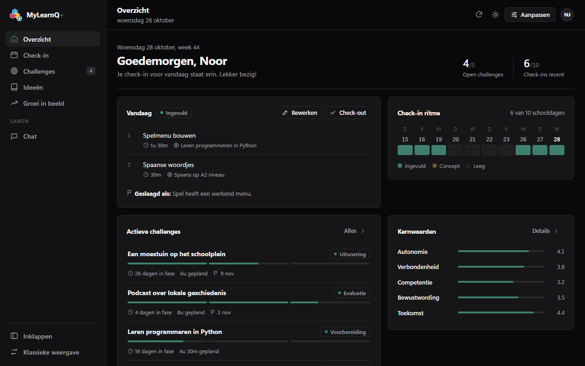

# MyLearnQ+

Een onofficiële browserextensie die [MyLearnQ](https://app.mylearnq.com) een nieuwe, rustige en volledig aanpasbare interface geeft, met een end-to-end versleutelde chat. In deze repository staat ook een kleine open source API-client voor dezelfde gegevens.



> **Let op:** dit project is niet gemaakt, gesteund of goedgekeurd door MyLearnQ of door een school. Het leest alleen je eigen gegevens uit, met de sessie waarmee je al bent ingelogd.

## Wat zit erin

| Map | Inhoud |
| --- | --- |
| [`extension/`](extension) | De browserextensie (Manifest V3, werkt in Chrome en Edge) |
| [`api/`](api) | `mylearnq-api`: een JavaScript client om je MyLearnQ-gegevens op te halen |
| [`store/`](store) | Teksten en afbeeldingen voor de Microsoft Edge Add-ons store |
| [`scripts/`](scripts) | Buildscript dat een zip maakt om te uploaden |

## Functies van de extensie

- **Nieuwe interface** voor Overzicht, Check-in, Challenges, Ideeën en Groei in beeld, gebouwd op de gegevens die de site zelf ook laadt.
- **Check-in en check-out direct invullen:** taken plannen, je check-in invullen en in een eigen tabblad een check-out doen kan helemaal in de nieuwe interface. Heeft je school maar drie werkblokken, zet dan het 4e blok uit onder Instellingen. De extensie gebruikt daarvoor dezelfde opslagacties als het formulier van MyLearnQ zelf. Challenges, ideeën en reflecties bewerk je in het originele formulier, geopend in een zijpaneel.
- **Helemaal aanpasbaar:** kies een van de kant-en-klare looks of stel alles zelf in onder Instellingen: kleuren en verlopen, achtergronden (ook je eigen foto), kaartstijl, lettertype, iconen, zijbalk links of rechts, breedte en dashboardblokken. Je look kun je delen met een code, en wie verder wil kan eigen CSS schrijven.
- **Inspiratiesessies verbergen** voor scholen waar die niet van toepassing zijn.
- **Klassieke weergave:** liever de originele site? Die krijg je met een eigen knop Instellingen en bijna dezelfde opties: looks, verlopen, achtergronden, kaartstijlen, breedte en eigen CSS.
- **Versleutelde chat** in groepen: maak een groep, kopieer de uitnodiging en stuur hem naar je klasgenoten (zie hieronder).

## Installeren

### Uit de store

Binnenkort in de Microsoft Edge Add-ons store.

### Handmatig (Chrome of Edge)

1. Download of clone deze repository.
2. Ga naar `chrome://extensions` of `edge://extensions`.
3. Zet **Ontwikkelaarsmodus** aan.
4. Klik op **Uitgepakte extensie laden** en kies de map `extension`.
5. Open of herlaad [app.mylearnq.com](https://app.mylearnq.com).

## Chat en beveiliging

Berichten gaan via de openbare relay [ntfy.sh](https://ntfy.sh). Ze worden in je browser versleuteld voordat ze worden verstuurd.

1. **Handtekening:** elk bericht wordt ondertekend met een ECDSA P-256 sleutel die alleen op jouw apparaat staat. Ontvangers controleren de handtekening en zien een sleutelvingerafdruk. Gebruikt iemand dezelfde naam met een andere sleutel, dan krijg je een waarschuwing.
2. **Groepslaag:** AES-256-GCM met een sleutel die met PBKDF2 (SHA-256, 250.000 rondes) wordt afgeleid van de geheime groepscode van 20 tekens (100 bits). Die code zit in de uitnodiging.
3. **Applaag:** nog een laag AES-256-GCM met een vaste appsleutel, zodat de relay geen herkenbare structuur ziet.

Elke laag gebruikt een eigen willekeurige IV en bindt context via additional data. Berichten hebben een uniek ID en een tijdstempel, zodat herhaalde of verplaatste berichten worden geweigerd.

**Eerlijk over de grenzen:**

- De appsleutel staat in de broncode en is voor iedereen gelijk. De echte bescherming is de groepscode in de uitnodiging: deel die alleen met mensen die je vertrouwt.
- ntfy.sh bewaart berichten maximaal 12 uur. Je eigen geschiedenis blijft versleuteld op je computer staan.
- De relay ziet wel wanneer er berichten zijn en vanaf welk IP-adres ze komen.
- Dit is een schoolproject en is niet door een expert gecontroleerd. Gebruik het niet voor echt gevoelige informatie.

## Bouwen

```powershell
./scripts/build.ps1
```

Dit maakt `dist/mylearnq-plus-<versie>.zip`, klaar om te uploaden naar de Edge Add-ons store.

## Privacy

Zie [PRIVACY.md](PRIVACY.md). Kort gezegd: geen tracking, geen eigen server, en alleen chatberichten verlaten je browser, versleuteld.

## Licentie

[MIT](LICENSE)
